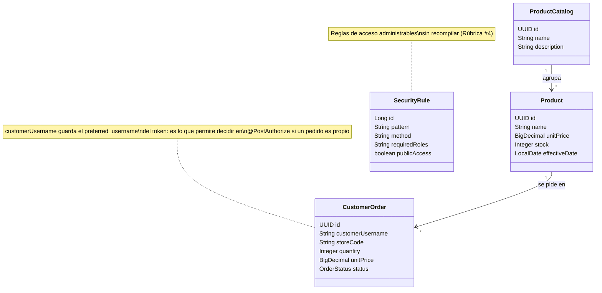
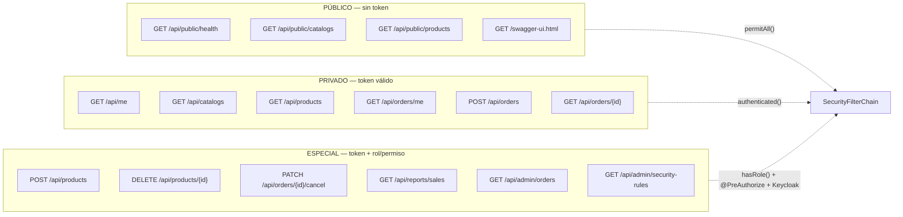

# 1. Modelo conceptual de las APIs (Rúbrica #3)

## 1.1 El caso de negocio

**GalaxyShop** es una cadena de tiendas de comestibles con venta en línea. El
dominio (catálogos, productos y pedidos) está tomado del proyecto de ejemplo
público [`jannie-louwrens/spring-boot-keycloak-angular`](https://github.com/jannie-louwrens/spring-boot-keycloak-angular),
actualizado aquí a Spring Boot 3 + Keycloak 26.

El proceso de negocio que se asegura es el **ciclo de venta**:

```
  Visitante            Cliente registrado         Personal de tienda        Gerencia / TI
     │                        │                           │                       │
     │ ve el catálogo         │ registra un pedido        │ repone el catálogo    │ anula pedidos
     │ (sin token)            │ consulta los suyos        │ atiende la caja       │ consulta reportes
     ▼                        ▼                           ▼                       ▼
  /api/public/**        /api/orders/**              /api/products (POST)     /api/reports/**
                        /api/me                                              /api/admin/**
```

## 1.2 Modelo de dominio



## 1.3 Los tres niveles de acceso

La rúbrica pide considerar accesos **públicos, privados y especiales**. Así se
reparten los endpoints:



## 1.4 Catálogo de endpoints

| # | Método | Ruta | Nivel | Exige | Decide |
|---|--------|------|-------|-------|--------|
| 1 | GET | `/api/public/health` | Público | — | filtro |
| 2 | GET | `/api/public/catalogs` | Público | — | filtro |
| 3 | GET | `/api/public/products` | Público | — | filtro |
| 4 | GET | `/api/me` | Privado | token válido | filtro |
| 5 | GET | `/api/me/permissions` | Privado | token válido | filtro |
| 6 | GET | `/api/catalogs` | Privado | rol `catalog-read` | filtro + `@PreAuthorize` |
| 7 | GET | `/api/products` | Privado | rol `catalog-read` + scope `catalog:view` | `@PreAuthorize` + **Keycloak** |
| 8 | GET | `/api/products/{id}` | Privado | rol `catalog-read` | `@PreAuthorize` |
| 9 | POST | `/api/products` | Especial | scope `catalog:edit` | **Keycloak** (rol + horario) |
| 10 | PUT | `/api/products/{id}` | Especial | scope `catalog:edit` | **Keycloak** |
| 11 | DELETE | `/api/products/{id}` | Especial | rol `catalog-delete` + scope `catalog:delete` | `@PreAuthorize` + **Keycloak** |
| 12 | GET | `/api/orders/me` | Privado | rol `order-read-own` | `@PreAuthorize` |
| 13 | GET | `/api/orders/{id}` | Privado | ser el dueño **o** `order-read-all` | `@PostAuthorize` |
| 14 | GET | `/api/orders/store` | Privado | rol `order-read-all` | `@PreAuthorize` |
| 15 | POST | `/api/orders` | Privado | rol `order-create` + scope `order:create` | `@PreAuthorize` + **Keycloak** |
| 16 | PATCH | `/api/orders/{id}/cancel` | Especial | scope `order:cancel` | **Keycloak** (grupo + horario) |
| 17 | GET | `/api/reports/sales` | Especial | rol de reporte + scope `report:view` | filtro + `@PreAuthorize` + **Keycloak** |
| 18 | GET | `/api/admin/orders` | Especial | rol de realm `gs-admin` | filtro + `@PreAuthorize` |
| 19 | GET | `/api/admin/security-rules` | Especial | rol de realm `gs-admin` | filtro + `@PreAuthorize` |

> Donde dice **Keycloak**, la decisión no está en el código: se resuelve
> evaluando las *Policies* y *Permissions* del cliente `shop-backend`
> (ver [05-seguridad-granular.md](05-seguridad-granular.md)).

## 1.5 Flujo de una petición protegida

```mermaid
sequenceDiagram
    participant A as Angular (shop-frontend)
    participant K as Keycloak (realm galaxyshop)
    participant S as API (shop-backend)

    A->>K: 1. Authorization Code + PKCE (S256)
    K-->>A: 2. access_token (JWT, 300 s) + refresh_token
    A->>S: 3. GET /api/orders/me  (Bearer access_token)

    S->>K: 4. JWKS (solo la primera vez; luego cacheado)
    K-->>S: 5. claves públicas del realm
    Note over S: 6. Valida firma, emisor (issuer) y audiencia (aud)
    Note over S: 7. Convierte realm_access y resource_access en authorities

    Note over S: 8. SecurityFilterChain: ¿la ruta permite este rol?
    Note over S: 9. @PreAuthorize sobre el método de servicio

    alt La operación tiene seguridad granular
        S->>K: 10. grant uma-ticket (permission = Pedidos#order:create)
        K-->>S: 11. {"result": true | access_denied}
    end

    S-->>A: 12. 200 con los datos, o 403 si algún control negó el paso
```

## 1.6 Por qué hay tres capas de control

No es redundancia: cada capa responde a una pregunta distinta y falla de forma
distinta.

| Capa | Pregunta que responde | Se cambia… |
|------|----------------------|-----------|
| `SecurityFilterChain` | ¿Esta **ruta** está abierta a este rol? | editando properties o una fila de `security_rule` |
| `@PreAuthorize` / `@PostAuthorize` | ¿Este **método** puede ejecutarse con este token? ¿El resultado es suyo? | en el código, con constantes |
| Authorization Services | ¿Este **usuario** puede ejercer este **scope** sobre este **recurso**, aquí y ahora? | en la consola de Keycloak, sin desplegar |

La última es la que permite, por ejemplo, ampliar el horario en que se pueden
anular pedidos sin tocar ni una línea de Java.
