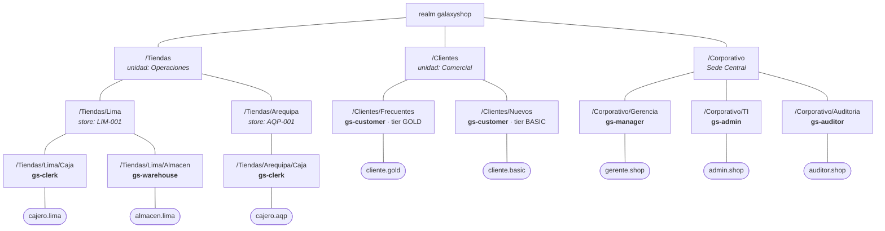

# 2. Matriz RACI (Rúbrica #3 y #5)

La rúbrica pide una matriz RACI construida **con usuarios, grupos y subgrupos,
roles y recursos**. Aquí están los cuatro ejes del modelo y cómo se cruzan.

## 2.1 Convención

| Letra | Significado en este proyecto |
|-------|------------------------------|
| **R** — *Responsible* | Ejecuta la operación en el sistema (tiene el permiso efectivo). |
| **A** — *Accountable* | Responde por el resultado; puede corregir o revertir lo que hizo el R. |
| **C** — *Consulted* | Necesita ver la información para opinar o validar, pero no la modifica. |
| **I** — *Informed* | Recibe el resultado, sin acceso de escritura. |
| *(vacío)* | Sin ningún acceso: la API responde 401 o 403. |

## 2.2 Estructura de identidades



**Ningún rol se asigna directamente a un usuario.** Todos se heredan del
subgrupo. Dar de alta a un cajero nuevo es ponerlo en `/Tiendas/Lima/Caja`, y
nada más.

## 2.3 Roles compuestos

```
gs-admin
  └── gs-manager
        ├── gs-clerk
        └── gs-warehouse
  └── gs-auditor
```

Un `gs-admin` arrastra los permisos de gerencia, tienda, almacén y auditoría sin
que haya que enumerarlos.

## 2.4 Matriz RACI del backend (Rúbrica #3)

Recursos del proceso de venta frente a los subgrupos del realm:

| Recurso / Operación | Endpoint | `/Clientes/*` | `/Tiendas/*/Caja` | `/Tiendas/*/Almacen` | `/Corporativo/Gerencia` | `/Corporativo/TI` | `/Corporativo/Auditoria` |
|---|---|:--:|:--:|:--:|:--:|:--:|:--:|
| **Catálogo** — consultar (público) | `GET /api/public/catalogs` | R | R | R | R | R | R |
| **Catálogo** — consultar (privado) | `GET /api/catalogs` | R | R | R | C | A | C |
| **Producto** — listar | `GET /api/products` | R | R | R | C | A | C |
| **Producto** — crear | `POST /api/products` | — | — | **R** | A | A | I |
| **Producto** — modificar | `PUT /api/products/{id}` | — | — | **R** | A | A | I |
| **Producto** — eliminar | `DELETE /api/products/{id}` | — | — | — | — | **R/A** | I |
| **Pedido** — registrar | `POST /api/orders` | **R** | — | — | A | A | I |
| **Pedido** — ver los propios | `GET /api/orders/me` | **R** | — | — | C | A | C |
| **Pedido** — ver los de la sede | `GET /api/orders/store` | — | **R** | — | A | A | C |
| **Pedido** — ver uno concreto | `GET /api/orders/{id}` | R *(solo el suyo)* | R | — | A | A | C |
| **Pedido** — anular | `PATCH /api/orders/{id}/cancel` | — | — | — | **R/A** | A | I |
| **Reporte de ventas** | `GET /api/reports/sales` | — | — | — | **R** | A | **C** |
| **Pedidos de la cadena** | `GET /api/admin/orders` | — | — | — | — | **R/A** | I |
| **Reglas de seguridad** | `GET /api/admin/security-rules` | — | — | — | — | **R/A** | C |

### Lectura de las celdas que importan

- **Cliente y pedidos.** El cliente es *R* sobre sus pedidos, pero nunca sobre
  los ajenos: `@PostAuthorize` compara el `preferred_username` del token con el
  dueño del pedido. Aunque adivine el UUID, recibe 403.
- **Almacén y catálogo.** El almacenero es *R* al crear productos, pero
  *Gerencia* y *TI* son *A*: pueden corregir o retirar lo que él publicó.
- **Anulación.** Solo Gerencia, y solo dentro del horario laboral. Es la
  operación con más controles porque revierte dinero.
- **Auditoría.** Es *C* en casi todo y **nunca R**: ve los reportes para
  validarlos, jamás modifica un dato.

## 2.5 Roles de cliente que respaldan la matriz

| Subgrupo | Rol de realm | Roles del cliente `shop-backend` |
|----------|--------------|----------------------------------|
| `/Clientes/Frecuentes`, `/Clientes/Nuevos` | `gs-customer` | `catalog-read`, `order-create`, `order-read-own` |
| `/Tiendas/*/Caja` | `gs-clerk` | `catalog-read`, `order-create`, `order-read-all`, `customer-read` |
| `/Tiendas/*/Almacen` | `gs-warehouse` | `catalog-read`, `catalog-write` |
| `/Corporativo/Gerencia` | `gs-manager` | `catalog-read`, `catalog-write`, `order-read-all`, `order-cancel`, `customer-read`, `report-read` |
| `/Corporativo/TI` | `gs-admin` | los seis anteriores + `catalog-delete` |
| `/Corporativo/Auditoria` | `gs-auditor` | `catalog-read`, `order-read-all`, `report-read` |

## 2.6 Matriz RACI del frontend Angular (Rúbrica #5)

Las mismas identidades, aplicadas a lo que cada perfil **ve** en la interfaz:

| Vista / Ruta | Nivel | `/Clientes/*` | `/Tiendas/*/Caja` | `/Tiendas/*/Almacen` | `/Corporativo/Gerencia` | `/Corporativo/TI` | `/Corporativo/Auditoria` | Visitante |
|---|---|:--:|:--:|:--:|:--:|:--:|:--:|:--:|
| `/` Inicio | Público | R | R | R | R | R | R | **R** |
| `/catalogo` (lectura) | Público | R | R | R | R | R | R | **R** |
| `/catalogo` botón *Comprar* | Privado | **R** | — | — | — | A | — | — |
| `/catalogo` botón *Eliminar* | Especial | — | — | — | — | **R/A** | — | — |
| `/pedidos` Mis pedidos | Privado | **R** | R | — | A | A | C | — |
| `/pedidos` botón *Anular* | Especial | — | — | — | **R/A** | A | — | — |
| `/perfil` Mi perfil | Privado | R | R | R | R | R | R | — |
| `/reportes` | Especial | — | — | — | **R** | A | **C** | — |
| `/administracion` | Especial | — | — | — | — | **R/A** | — | — |

### Cómo se aplica en el código

1. **La ruta** se protege con `authGuard` (exige sesión) o `rolesGuard`
   (exige un rol declarado en `data.roles`).
2. **El menú** se dibuja con `keycloak.tieneAlgunRol(...)`: el usuario no ve
   enlaces que no puede abrir.
3. **Los botones de acción** se dibujan con `keycloak.puede(recurso, scope)`,
   que consulta los permisos granulares que Keycloak devolvió en `/api/me`.

> La interfaz **esconde** lo que no corresponde, pero no es ahí donde se decide:
> quien llame a la API a mano recibirá igualmente un 403. El frontend evita
> ofrecer un botón que iba a fallar; la seguridad real vive en el backend y en
> Keycloak.
