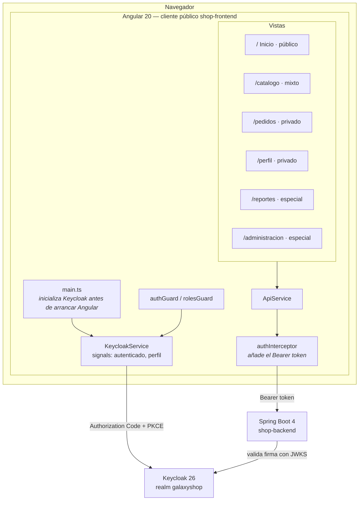
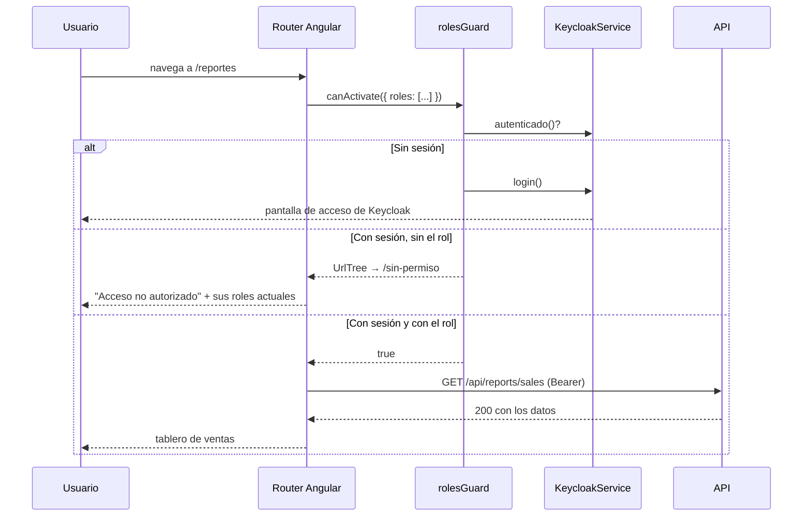

# 3. Modelo conceptual del frontend (Rúbrica #5)

## 3.1 Arquitectura



## 3.2 Decisiones de diseño y por qué

| Decisión | Motivo |
|----------|--------|
| **Cliente público con PKCE S256** | Un SPA no puede guardar un secreto: cualquiera abre las herramientas de desarrollo y lo lee. PKCE protege el intercambio del código sin necesitar secreto. |
| **`onLoad: 'check-sso'`, no `login-required`** | El escaparate debe verse sin identificarse. Con `login-required` el visitante chocaría con la pantalla de acceso antes de ver un solo producto. |
| **Keycloak se inicializa antes de `bootstrapApplication`** | Evita el parpadeo de "invitado → usuario" y que un guard se evalúe antes de saber si hay sesión. |
| **`updateToken(60)` cada 30 s** | El access token dura 300 s. Se renueva cuando le quedan 60, de forma transparente. |
| **El menú se dibuja por rol; los botones, por permiso granular** | Un rol dice *quién eres*; un permiso granular dice *qué puedes hacer ahora* (incluye la política de horario). |
| **`/api/me` devuelve el RPT completo** | Así el SPA conoce sus permisos en una sola llamada, en lugar de preguntar a Keycloak por cada botón. |

## 3.3 Los tres niveles en el enrutador

```typescript
// PÚBLICO: sin guard
{ path: '',         loadComponent: () => import('./pages/inicio/inicio') }
{ path: 'catalogo', loadComponent: () => import('./pages/catalogo/catalogo') }

// PRIVADO: exige sesión
{ path: 'pedidos', canActivate: [authGuard], ... }
{ path: 'perfil',  canActivate: [authGuard], ... }

// ESPECIAL: exige rol
{ path: 'reportes',       canActivate: [rolesGuard],
  data: { roles: ['gs-auditor', 'gs-manager', 'gs-admin', 'report-read'] } }
{ path: 'administracion', canActivate: [rolesGuard],
  data: { roles: ['gs-admin'] } }
```

## 3.4 Qué ve cada perfil al entrar

| Usuario | Menú visible | Botones en el catálogo |
|---------|--------------|------------------------|
| *(sin sesión)* | Inicio · Catálogo | ninguno |
| `cliente.gold` | Inicio · Catálogo · Mis pedidos · Mi perfil | **Comprar** |
| `cajero.lima` | Inicio · Catálogo · Mis pedidos · Mi perfil | ninguno *(no es `gs-customer`)* |
| `almacen.lima` | Inicio · Catálogo · Mis pedidos · Mi perfil | ninguno *(edita desde la API/Postman)* |
| `auditor.shop` | … + **Reportes** | ninguno |
| `gerente.shop` | … + **Reportes** | ninguno; en *Mis pedidos* aparece **Anular** |
| `admin.shop` | … + **Reportes** + **Administración** | **Eliminar** |

## 3.5 Flujo de acceso a una vista especial



## 3.6 Estructura de archivos

```
frontend/src/
├── main.ts                         arranque: Keycloak primero, Angular después
├── environments/
│   ├── environment.ts              url de Keycloak, realm y clientId (desarrollo)
│   └── environment.prod.ts         equivalente productivo
└── app/
    ├── app.ts / app.html           cabecera, menú por rol y pie
    ├── app.routes.ts               los tres niveles de acceso
    ├── app.config.ts               router + HttpClient con interceptor
    ├── core/
    │   ├── keycloak.service.ts     sesión, roles y permisos granulares
    │   ├── auth.interceptor.ts     añade el Bearer token a la API
    │   ├── auth.guard.ts           authGuard y rolesGuard
    │   └── api.service.ts          cliente HTTP tipado
    └── pages/
        ├── inicio/                 público
        ├── catalogo/               mixto (público + acciones por permiso)
        ├── pedidos/                privado
        ├── perfil/                 privado — muestra el token en claro
        ├── reportes/               especial
        └── administracion/         especial
```

## 3.7 Puesta en marcha

```bash
cd frontend
npm install
npm start          # http://localhost:4200
```

Requiere que Keycloak (`:8081`) y la API (`:8080`) estén levantados.
