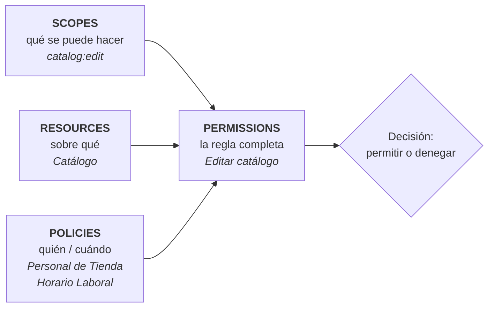

# 5. Seguridad granular (Rúbrica #6)

> *"Implementar seguridad granular en un cliente específico, creando sus
> respectivos Scopes, Resources, Policy & Permission."*

Todo lo que sigue está configurado en el cliente **`shop-backend`** del realm
`galaxyshop`, con Authorization Services (UMA 2.0) activado.

## 5.1 El modelo de cuatro piezas



La diferencia con `@PreAuthorize("hasRole(...)")` es dónde vive la regla: aquí
**es un dato de Keycloak, no código**. Ampliar el horario de anulaciones o
sumar un grupo autorizado se hace en la consola y surte efecto en la siguiente
petición, sin recompilar ni desplegar.

## 5.2 Scopes (7)

| Scope | Operación que representa |
|-------|--------------------------|
| `catalog:view` | consultar el catálogo |
| `catalog:edit` | crear o modificar productos |
| `catalog:delete` | eliminar productos |
| `order:view` | consultar pedidos |
| `order:create` | registrar un pedido |
| `order:cancel` | anular un pedido |
| `report:view` | consultar reportes de venta |

## 5.3 Resources (3)

| Recurso | Tipo | URIs | Scopes |
|---------|------|------|--------|
| **Catalogo** | `urn:galaxyshop:resources:catalog` | `/api/catalogs`, `/api/catalogs/*`, `/api/products`, `/api/products/*` | `catalog:view`, `catalog:edit`, `catalog:delete` |
| **Pedidos** | `urn:galaxyshop:resources:order` | `/api/orders`, `/api/orders/*` | `order:view`, `order:create`, `order:cancel` |
| **Reportes** | `urn:galaxyshop:resources:report` | `/api/reports`, `/api/reports/*` | `report:view` |

## 5.4 Policies (9)

| Policy | Tipo | Regla |
|--------|------|-------|
| Rol Cliente | `role` | tiene el rol de realm `gs-customer` |
| Rol Personal de Tienda | `role` | tiene `gs-clerk` **o** `gs-warehouse` (afirmativa) |
| Rol Administrador | `role` | tiene `gs-admin` |
| Grupo Gerencia | `group` | pertenece a `/Corporativo/Gerencia` |
| Grupo Auditoria | `group` | pertenece a `/Corporativo/Auditoria` |
| **Horario Laboral** | `time` | la hora del servidor está entre las 06:00 y las 22:59 |
| Cliente o Personal de Tienda | `aggregate` | *Rol Cliente* **O** *Rol Personal de Tienda* |
| Gerencia en Horario Laboral | `aggregate` | *Grupo Gerencia* **Y** *Horario Laboral* |
| Gerencia o Auditoria | `aggregate` | *Grupo Gerencia* **O** *Grupo Auditoria* |

Se usan cuatro tipos distintos a propósito: por **rol**, por **grupo**, por
**tiempo** y **agregadas**, para cubrir el abanico que ofrece Keycloak.

## 5.5 Permissions (7)

| Permission | Recurso | Scope | Policies | Estrategia |
|------------|---------|-------|----------|-----------|
| Ver catálogo | Catalogo | `catalog:view` | Cliente o Personal de Tienda | afirmativa |
| **Editar catálogo** | Catalogo | `catalog:edit` | Rol Personal de Tienda **+** Horario Laboral | **unánime** |
| Eliminar del catálogo | Catalogo | `catalog:delete` | Rol Administrador | unánime |
| Ver pedidos | Pedidos | `order:view` | Cliente o Personal de Tienda | afirmativa |
| Crear pedido | Pedidos | `order:create` | Rol Cliente | unánime |
| **Anular pedido** | Pedidos | `order:cancel` | Gerencia en Horario Laboral | **unánime** |
| Ver reportes | Reportes | `report:view` | Gerencia o Auditoria | afirmativa |

*Unánime* significa que deben cumplirse **todas** las policies; *afirmativa*, que
basta con una.

## 5.6 Matriz de decisión verificada

Resultado real de consultar a Keycloak con el grant `uma-ticket`, dentro del
horario laboral:

| Usuario | `order:create` | `order:cancel` | `catalog:edit` | `catalog:delete` | `report:view` |
|---------|:---:|:---:|:---:|:---:|:---:|
| `cliente.gold` | ✅ | ❌ | ❌ | ❌ | ❌ |
| `cliente.basic` | ✅ | ❌ | ❌ | ❌ | ❌ |
| `cajero.lima` | ❌ | ❌ | ✅ | ❌ | ❌ |
| `almacen.lima` | ❌ | ❌ | ✅ | ❌ | ❌ |
| `gerente.shop` | ❌ | ✅ | ✅ | ❌ | ✅ |
| `auditor.shop` | ❌ | ❌ | ❌ | ❌ | ✅ |
| `admin.shop` | ❌ | ✅ | ✅ | ✅ | ✅ |

Dos lecturas que conviene señalar en la sustentación:

- **`gerente.shop` no puede eliminar del catálogo.** Gerencia supervisa, pero la
  operación destructiva está reservada a TI. La jerarquía de roles no implica
  poder absoluto.
- **`cliente.gold` no puede anular su propio pedido.** Anular mueve dinero: lo
  hace Gerencia, y solo en horario de oficina.

## 5.7 Cómo lo consulta el backend

```java
@PreAuthorize("@authorizationGranularService.permite('Pedidos', 'order:cancel')")
public PedidoDto anularPedido(UUID id) { ... }
```

`AuthorizationGranularService` traduce esa expresión a una llamada UMA:

```http
POST /realms/galaxyshop/protocol/openid-connect/token
Authorization: Bearer <access_token del usuario>

grant_type=urn:ietf:params:oauth:grant-type:uma-ticket
audience=shop-backend
permission=Pedidos#order:cancel
response_mode=decision
```

Keycloak responde `{"result": true}` o un `403 access_denied`. Las decisiones se
cachean 30 segundos por usuario y permiso (`app.security.granular.cache-seconds`)
para no consultar en cada petición.

## 5.8 Cómo lo consume el frontend

`GET /api/me` devuelve el RPT completo, y Angular decide con él qué botones
dibujar:

```json
{
  "usuario": "cliente.gold",
  "permisosGranulares": [
    { "rsname": "Catalogo", "scopes": ["catalog:view"] },
    { "rsname": "Pedidos",  "scopes": ["order:create", "order:view"] }
  ]
}
```

```typescript
puedeComprar(): boolean {
  return this.keycloak.puede('Pedidos', 'order:create');
}
```

## 5.9 Cómo probarlo

**Desde Postman** — carpeta *5. Seguridad granular (UMA 2.0)*: 10 peticiones que
comprueban cada decisión.

**Desde la consola de Keycloak** — `Clients → shop-backend → Authorization →
Evaluate`: se elige un usuario y un recurso y Keycloak explica qué policy
concedió o denegó el acceso.

**Demostración en vivo del horario.** Cambiar la policy *Horario Laboral* a un
rango que no incluya la hora actual y repetir la anulación de un pedido: pasa de
200 a 403 sin tocar ni reiniciar la aplicación. Es la forma más clara de mostrar
que la regla vive en Keycloak.
